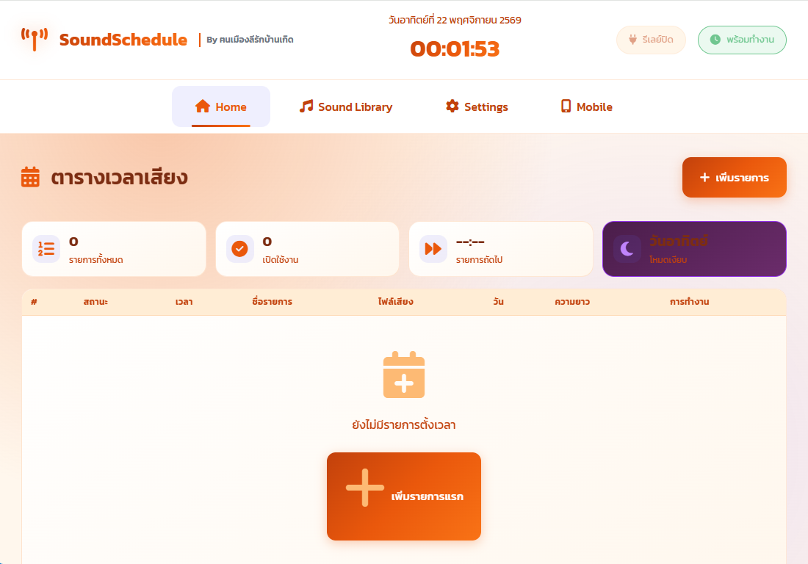

# 🔔 SoundSchedule

โปรแกรมตั้งเวลาเล่นเสียงอัตโนมัติ สำหรับกริ่งโรงเรียน เสียงตามสาย และประกาศในหน่วยงาน
**แจกฟรี** ใช้ได้ทั้งโรงเรียน หน่วยงานราชการ อบต. วัด และชุมชน

## ⬇️ ดาวน์โหลด

ไปที่หน้า **[Releases](../../releases/latest)** แล้วโหลดไฟล์ `SoundSchedule_Setup_vX.X.X.exe`

> ดาวน์โหลดจากหน้านี้เท่านั้น โปรแกรมนี้แจกฟรี **ถ้ามีคนขาย แปลว่าไม่ใช่ของแท้**

ใช้กับ Windows 10 / 11 (64 บิต)

## ความสามารถ

- ตั้งเวลาเล่นเสียงได้ไม่จำกัด เลือกวันในสัปดาห์ เล่นหลายไฟล์ต่อกัน
- ข้ามวันเสาร์ อาทิตย์ และวันหยุดราชการไทยอัตโนมัติ ตั้งช่วงห้ามเล่นเสียงได้
- พิมพ์ข้อความแปลงเป็นเสียงพูดภาษาไทย และบันทึกเสียงผ่านหน้าเว็บ
- ประกาศจากมือถือ มีเสียงติ๊งหน่องก่อน-หลัง เข้าด้วย PIN
- เปิด-ปิดเครื่องขยายเสียงอัตโนมัติผ่านรีเลย์ (USB Relay, Tasmota, Shelly, Sonoff)
- ส่งเสียงไปหลายอาคารผ่านวงแลน (RTP Multicast) แบ่งกลุ่มได้
- แจ้งเตือนผ่าน Telegram
- ผู้ใช้หลายระดับ พร้อมบันทึกประวัติการใช้งาน
- ใส่ชื่อและโลโก้หน่วยงาน เลือกธีมสีได้
- ทำงานเงียบๆ ที่ไอคอนข้างนาฬิกา เปิดพร้อมเครื่องได้

## ติดตั้ง

1. ดับเบิลคลิกไฟล์ Setup ที่โหลดมา
2. ยอมรับข้อตกลงการใช้งาน แล้วกด Next ไปเรื่อยๆ
   - ตัวเลือก **เปิดโปรแกรมอัตโนมัติเมื่อเปิดเครื่อง** แนะนำให้ติ๊กไว้ เปิดคอมตอนเช้ากริ่งก็พร้อมทำงาน
   - ตัวเลือก **อนุญาตใน Windows Firewall** ติ๊กไว้ ถ้าจะใช้งานจากมือถือหรือเครื่องอื่น
3. โปรแกรมจะติดตั้งที่ `C:\SoundSchedule` และเปิดหน้าเว็บให้อัตโนมัติ

> **Windows แจ้งเตือน "Windows protected your PC"?**
> เป็นเพราะโปรแกรมไม่ได้ซื้อใบรับรองดิจิทัล (มีค่าใช้จ่ายรายปี) กด **More info → Run anyway** เพื่อติดตั้งต่อ

### อัปเดตเวอร์ชันใหม่

โหลด Setup ตัวใหม่แล้วติดตั้งทับได้เลย ตารางเวลา การตั้งค่า และไฟล์เสียงเดิมยังอยู่ครบ

## เริ่มใช้งาน

เปิดเบราว์เซอร์ไปที่ `http://localhost:5000` (หรือดับเบิลคลิกไอคอนข้างนาฬิกา)

| | ค่าเริ่มต้น |
|---|---|
| ชื่อผู้ใช้ | `admin` |
| รหัสผ่าน | `admin1234` |
| PIN หน้ามือถือ | `1234` |

เข้าครั้งแรกโปรแกรมจะให้ตั้งรหัสผ่านและ PIN ใหม่ก่อนใช้งาน

**เครื่องอื่นและมือถือ** ในวงแลนเดียวกัน: คลิกขวาไอคอนข้างนาฬิกา → **ข้อมูลเซิร์ฟเวอร์** จะเห็นที่อยู่สำหรับเข้าใช้ เช่น `http://192.168.1.10:5000`

**ลืมรหัสผ่าน:** ปิดโปรแกรม แล้วเปิด Start Menu → SoundSchedule → **รีเซ็ตรหัสผ่าน admin**

## ไอคอนข้างนาฬิกา (System Tray)

โปรแกรมทำงานเบื้องหลัง ไม่มีหน้าต่างค้างบน Taskbar คลิกขวาที่ไอคอนเพื่อ

- เปิดหน้าเว็บ (ดับเบิลคลิกก็ได้)
- เปิดหน้ามือถือ
- ดูข้อมูลเซิร์ฟเวอร์
- เปิดโฟลเดอร์โปรแกรม
- ปิดโปรแกรม (ปิดแล้วเสียงตามเวลาจะไม่ดัง)

## รีเลย์ที่รองรับ

| แบบ | อุปกรณ์ |
|---|---|
| USB / COM Port | LC USB Relay (Superparis/LCUS), CH340 USB Relay, Arduino/ESP32 |
| Wi-Fi | Tasmota, Shelly Gen1 / Gen2 / Gen3, Sonoff DIY |

## ส่งเสียงหลายอาคาร (RTP)

ตั้งค่าที่ **ตั้งค่า → RTP Streaming** เพิ่มกลุ่มละ 1 IP เช่น อาคาร 1 = `239.255.0.1`, อาคาร 2 = `239.255.0.2`
ฝั่งรับเสียงใช้ VLC: Media → Open Network Stream → `rtp://@239.255.0.1:5004`

Router หรือ Switch บางรุ่นต้องเปิด Multicast / IGMP ก่อน

## ข้อควรรู้

- ใช้ในวงแลนของหน่วยงาน **ไม่ควรเปิดพอร์ต 5000 ออกอินเทอร์เน็ต** ถ้าจำเป็นต้องเข้าจากข้างนอก ใช้ VPN เช่น Tailscale
- ข้อมูลทั้งหมดอยู่ที่ `C:\SoundSchedule\data` และ `C:\SoundSchedule\sounds` สำรองไว้เป็นระยะ หรือใช้ปุ่มสำรองข้อมูลในหน้าตั้งค่า
- การแปลงข้อความเป็นเสียงและ Telegram ต้องใช้อินเทอร์เน็ต ส่วนการเล่นเสียงตามเวลาไม่ต้องใช้

## แจ้งปัญหา / ขอฟีเจอร์

แจ้งได้ที่ **[Issues](../../issues)** บอกเวอร์ชันโปรแกรม (ดูได้ท้ายหน้าเว็บ) และแนบไฟล์ `C:\SoundSchedule\data\soundschedule.log` ถ้ามี

## ข้อตกลงการใช้งาน

ใช้ฟรี แจกต่อได้เฉพาะไฟล์ติดตั้งต้นฉบับ **ห้ามจำหน่าย ห้ามดัดแปลง** อ่านฉบับเต็มที่ [LICENSE.txt](LICENSE.txt)

---

พัฒนาโดย **ฅนเมืองลีรักบ้านเกิด**
